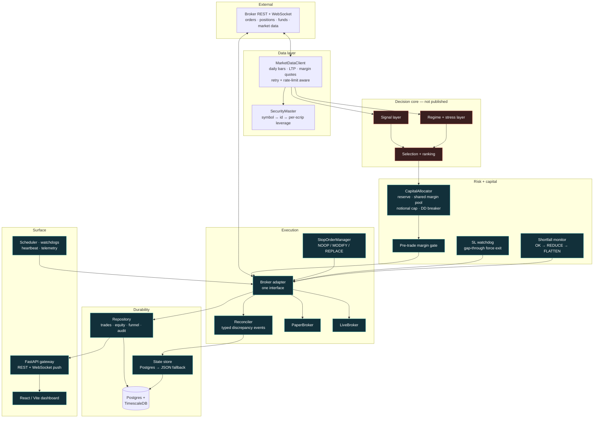
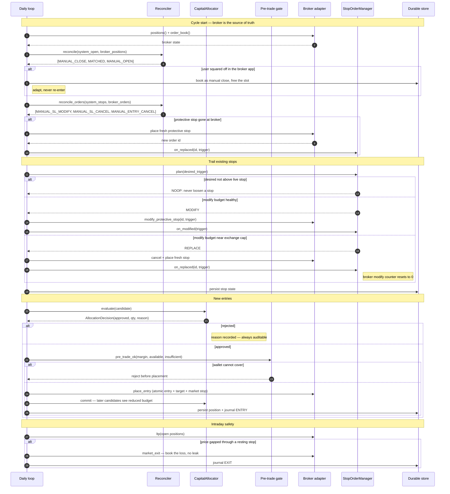

# MarginOps

**A systematic multi-asset trading platform covering research, risk management and live order
execution across NSE equities, options and commodity derivatives.**

> This is a **public engineering overview**. The strategy itself (signal construction, feature
> definitions, regime thresholds, tuned parameters and instrument selection) stays in a private
> repository and is not published anywhere. Everything shown here is the *execution* system: the
> order lifecycle, reconciliation, risk mechanisms, durability, and test infrastructure. That
> boundary is deliberate and is drawn explicitly in the architecture diagram below.
>
> The code excerpts on this page are quoted verbatim from the private repository, with file paths
> and line numbers, so the engineering claims here are checkable rather than asserted.
>
> The full published and never-published lists are in [DISCLOSURE.md](DISCLOSURE.md).

---

## Overview

MarginOps is a systematic trading platform spanning the full lifecycle of a quantitative
trading system: historical data ingestion, a research and backtesting layer, a regime-aware
decision pipeline, and a live/paper execution layer trading through a live brokerage API on
NSE equities, index/stock options, and MCX commodity derivatives.

This overview documents the execution half of that lifecycle. The research and backtesting
half is deliberately not argued here; see [On backtesting](#on-backtesting) below.

It's built as a real operating system for a trading strategy, not a research notebook, with
the infrastructure that separates a strategy that looks good on paper from one that is safe to
run unattended against real capital: paper/live execution parity, atomic order submission, automated broker reconciliation,
a hard-gated live-trading switch, scheduled model retraining, and a real-time monitoring
dashboard.

## Motivation

Most public quant/trading projects stop at the backtest. The harder engineering problems start
afterwards: building the execution, reconciliation, risk and observability layers that let a
system act on real capital safely and unattended, and that fail in ways an operator can
diagnose. A strategy is one component in that system. MarginOps was built to own the whole
operating surface around it, and this overview is about that surface.

## What this system does when things go wrong

This is the part worth reading. Anyone can place an order; the engineering is in what happens
on the bad days. Each of these is a real failure mode that was hit, diagnosed and fixed. The
linked code is quoted further down.

| Failure mode | How the system handles it |
|---|---|
| Price **gaps straight through** a resting stop overnight | A watchdog force-exits at market rather than waiting for a trigger that will never fire. The loss books at the gap; it never leaks. |
| The user **squares off a position manually** in the broker's app | Reconciliation detects it, books it as a manual close, frees the capital slot, and does not re-enter. The broker is the source of truth; the system adapts and never fights it. |
| The user **moves or cancels a protective stop** by hand | Order-level reconciliation classifies it and adopts the broker's value, or re-arms a fresh stop if ours vanished. |
| A long-held trailing stop **hits the exchange's modification cap** | A modify-budget manager switches from MODIFY to a cancel-and-replace handshake, resetting the broker's counter before the wall is reached. |
| The process **crashes mid-placement** | Order keys are *derived*, not random, so the retry produces the same key and the broker recognises it as the same order instead of opening a second position. |
| The wallet enters **margin shortfall** | A graduated ladder de-risks on day one and force-flattens by day two, before the broker's fund-lock window. |
| **Postgres or Redis is unavailable** | The live loop degrades to a JSON ledger and keeps trading. Richer persistence is an enhancement, not a hard dependency. |

## By the numbers

| Metric | Value |
|---|---|
| Codebase | 481 tracked Python files, 59,172 lines, plus a 26-component React/TypeScript dashboard |
| Automated tests | **123 passing** across three suites (execution loop, reconciliation, risk guards, stop manager, idempotency, paper broker, allocator, backtest, data layer, margin/greeks) |
| Historical data | Broker-verified dataset, 450+ instruments, 500K+ price bars |
| Asset coverage | NSE equities, index/stock options, MCX commodity options & futures |
| Build cadence | 193 commits |

*No strategy performance figures, meaning returns, Sharpe, profit factor or drawdown, are
published here or anywhere public, by design. No backtest results are published either, for the
reason given in [On backtesting](#on-backtesting). The statistics above describe engineering
scope only.*

## Architecture

The red blocks are the proprietary decision core and are not published. Everything else is
execution engineering, and is what the code excerpts below are drawn from.



## Order lifecycle: including intervention handling

The happy path is the boring part. This shows the reconciliation and stop-management paths that
run *before* any new order is considered.



## Code

Five excerpts, quoted verbatim from the private repository. None of these touch signal
generation, feature definitions, or tuned strategy parameters.

### 1. Idempotency key derivation

`live/marginops/utils/idempotency.py`

An order key must be **derived, never random**. If the process dies between generating a key and
the broker acknowledging the order, a random key regenerates differently on retry, the broker
sees an unrelated order, and the position opens twice. The trade's identity is
`(sleeve, instrument, trading day)`. Dropping the day would make a re-entry weeks later collide
with the original order's id.

```python
MAX_LEN = 30
_DIGEST_LEN = 4


def correlation_id(sleeve: str, instrument: str, day, *, max_len: int = MAX_LEN) -> str:
    """Deterministic idempotency key for one trade intent. Same inputs -> same key, always.

    >>> correlation_id("A", "RELIANCE", "2026-07-30")
    'A-RELIANCE-2026-07-30'
    """
    d = str(day)[:10]
    key = f"{sleeve}-{instrument}-{d}"
    if len(key) <= max_len:
        return key
    # truncation is lossy, so bind the full key in with a deterministic digest
    digest = hashlib.sha1(key.encode("utf-8")).hexdigest()[:_DIGEST_LEN]
    keep = max_len - len(sleeve) - len(d) - _DIGEST_LEN - 3      # 3 separators
    return f"{sleeve}-{instrument[:max(keep, 1)]}-{d}-{digest}"[:max_len]
```

Brokers cap correlation-id length (30 characters here). Truncating alone would let two long
instrument names collapse to the same key, so the digest of the *full* key is appended:
uniqueness survives truncation and the result is still reproducible.

### 2. Order-level reconciliation classifier

`live/marginops/engine/reconcile.py:73-109`

The broker is the source of truth. This diffs our tracked protective stops and pending entries
against the live order book and emits typed events. Note the distinction it draws: `TRADED` and
`EXPIRED` are normal lifecycle, not human intervention. Conflating the two would cause the
system to "correct" orders that were never touched.

```python
def reconcile_orders(system_stops: list, broker_orders: list, *, tick: float = 0.05) -> list[ReconEvent]:
    """Order-level reconciliation for user intervention on our PROTECTIVE STOPS / pending entries.
    The broker is the source of truth; we adapt and never fight.
    [...parameter docs elided...]
      • our stop's trigger differs from the broker's      -> MANUAL_SL_MODIFY (adopt broker)
      • our stop order id absent / CANCELLED at broker     -> MANUAL_SL_CANCEL (re-arm next cycle)
      • our pending entry absent / CANCELLED at broker     -> MANUAL_ENTRY_CANCEL (free the slot)
    Orders the broker shows as TRADED/EXPIRED are normal lifecycle, not intervention.
    """
    by_id = {str(_get(o, "orderId")): o for o in broker_orders if _get(o, "orderId") is not None}
    gone = {"CANCELLED", "REJECTED", "EXPIRED"}
    events: list[ReconEvent] = []
    for s in system_stops:
        oid = _get(s, "sl_order_id") or _get(s, "order_id")
        sym = _get(s, "symbol") or _get(s, "stock") or str(oid)
        kind = (_get(s, "kind") or "stop")
        bo = by_id.get(str(oid)) if oid is not None else None
        status = str(_get(bo, "orderStatus") or "").upper() if bo else ""
        if oid is None or bo is None or status in gone:
            if kind == "entry":
                events.append(ReconEvent(ReconKind.MANUAL_ENTRY_CANCEL, str(oid), sym,
                                         "pending entry gone at broker -> user cancelled, free slot"))
            else:
                events.append(ReconEvent(ReconKind.MANUAL_SL_CANCEL, str(oid), sym,
                                         "protective stop gone at broker -> re-arm a fresh stop"))
            continue
        if kind == "stop":
            our_trig = float(_get(s, "trigger_price") or 0)
            brk_trig = float(_get(bo, "triggerPrice") or 0)
            if brk_trig > 0 and abs(brk_trig - our_trig) > tick:
                events.append(ReconEvent(ReconKind.MANUAL_SL_MODIFY, str(oid), sym,
                                         f"user moved stop {our_trig}->{brk_trig}; adopt broker truth"))
    return events
```

### 3. Working around the exchange's order-modification cap

`live/marginops/engine/stop_manager.py:58-85`

An exchange caps how many times a single order may be modified. A trailing stop on a position
held for weeks will approach that cap. This decides between re-pricing the existing order and
cancelling/replacing it (the replace resets the broker's counter) and keeps the counter
truthful via executor callbacks so the decision is always made on real state.

```python
@dataclass
class StopOrderManager:
    state: StopState

    def plan(self, desired_trigger: float, *, tick: float = 0.05) -> StopDecision:
        """Decide what to do to move the stop to `desired_trigger`. Never lowers the stop."""
        st = self.state
        if st.sl_order_id is None:
            return StopDecision(StopAction.REPLACE, desired_trigger, "no live stop -> place one")
        if desired_trigger <= st.trigger_price + tick / 2:
            return StopDecision(StopAction.NOOP, st.trigger_price, "stop not raised")
        # would this modify exhaust the budget? then cancel+replace (counter resets to 0)
        if st.modify_count + 1 >= st.max_modifies - st.safety:
            return StopDecision(StopAction.REPLACE, desired_trigger,
                                f"modify budget near limit ({st.modify_count}/{st.max_modifies}) -> cancel+replace")
        return StopDecision(StopAction.MODIFY, desired_trigger,
                            f"modify {st.modify_count + 1}/{st.max_modifies}")

    # ---- executor callbacks (keep the counter truthful) ----
    def on_modified(self, new_trigger: float) -> None:
        self.state.trigger_price = new_trigger
        self.state.modify_count += 1

    def on_replaced(self, new_sl_order_id: str, new_trigger: float) -> None:
        self.state.sl_order_id = new_sl_order_id
        self.state.trigger_price = new_trigger
        self.state.modify_count = 0                 # fresh order -> counter resets
        self.state.replaced_count += 1
```

### 4. Margin-shortfall escalation

`live/marginops/engine/risk_guards.py:40-67`

A graduated response keyed to an external deadline. The broker locks funds if a shortfall
persists; the system acts far sooner, so a shortfall never survives to that window. Pure
function with no I/O, so its inputs and outputs can be tested directly.

```python
class ShortfallAction(Enum):
    OK = "ok"                       # no shortfall
    REDUCE = "reduce"               # shortfall present -> de-risk + alert (still early)
    URGENT_FLATTEN = "urgent"       # shortfall lingering -> force-flatten before broker lock


@dataclass(frozen=True)
class ShortfallVerdict:
    action: ShortfallAction
    alert: bool
    reason: str


def shortfall_monitor(insufficient_balance: float, days_in_shortfall: int,
                      broker_lock_days: int = 5) -> ShortfallVerdict:
    """Decide how hard to act on a wallet shortfall. The broker locks funds if a shortfall
    persists `broker_lock_days` (~4-5). We act FAR sooner: de-risk on day 1, force-flatten
    by day 2 — so a shortfall never survives to the lock window."""
    if insufficient_balance <= 0:
        return ShortfallVerdict(ShortfallAction.OK, False, "no-shortfall")
    # day 0/1: reduce exposure to clear it; always alert the user to top up
    if days_in_shortfall < 2:
        return ShortfallVerdict(ShortfallAction.REDUCE, True,
                                f"shortfall Rs{insufficient_balance:.0f} day{days_in_shortfall} -> de-risk")
    # day 2+ and still short: force-flatten well before the broker lock (~day 4-5)
    return ShortfallVerdict(ShortfallAction.URGENT_FLATTEN, True,
                            f"shortfall {days_in_shortfall}d -> flatten before broker lock@{broker_lock_days}d")
```

### 5. A regression test written from a real bug

`live/tests/test_intraday_fill.py`

This test exists because of the incident documented in the next section. It pins the invariant
that the bug violated.

```python
def _pending(entry=100.0, stop_dist=5.0):
    return {"stock": "ACME", "entry": entry, "stop_dist": stop_dist,
            "init_stop": entry - stop_dist, "cur_stop": entry - stop_dist,
            "filled": False, "hh": entry, "bars": 0}


def test_favourable_fill_preserves_stop_level_and_reduces_max_loss():
    p = _pending()                                   # limit 100, stop 95 -> 5.00/sh at risk
    assert apply_intraday_fill(p, ltp=98.0) is True

    assert p["filled"] is True
    assert p["entry"] == 98.0                        # entry moves to the actual fill
    assert p["init_stop"] == 95.0                    # structural stop UNCHANGED
    assert p["cur_stop"] == 95.0
    # the whole point: max loss is now strictly smaller than planned
    assert p["entry"] - p["init_stop"] == 3.0
    assert p["entry"] - p["init_stop"] < 5.0


def test_repeated_fill_attempts_do_not_walk_the_stop_down():
    """Idempotence guard: re-running the check must not compound the entry/stop drift."""
    p = _pending()
    apply_intraday_fill(p, ltp=98.0)
    stop_after_first = p["init_stop"]
    # a second pass at a lower price would previously have re-anchored again
    apply_intraday_fill(p, ltp=96.0)
    assert p["init_stop"] == stop_after_first == 95.0
```

## Incident post-mortem: stop-loss re-based on a favourable fill

A worked example of how defects in this system get handled. Chosen because the root cause is
conceptual rather than typographical. The code did exactly what it was written to do.

**Severity:** risk-integrity failure. It produced no crash, failed order or log warning.

**Symptom.** A pending limit entry that filled intraday at a price *better* than the signal limit
produced a position whose rupee risk was unchanged from plan, when it should have been strictly
lower. Detectable only by comparing intended max-loss against realised max-loss across filled
positions.

**Root cause.** The intraday fill handler re-derived the protective stop from the *actual fill
price* rather than preserving the stop computed at signal time:

```python
p["init_stop"] = float(ltp - p.get("stop_dist", 0))
p["cur_stop"] = p["init_stop"]
```

Because `stop_dist` was held constant while the stop was re-anchored to a lower fill price, the
stop slid down by exactly the amount saved on entry. The favourable fill was converted from a
*risk reduction* into *unchanged risk at a lower entry*, silently spending the windfall on a
wider effective stop.

The conceptual error: treating `stop_dist` as the invariant. The invariant is the **stop price
level**, which was derived from market structure at signal time and has nothing to do with what
price we happened to get.

**Fix.** Delete the re-derivation. Two lines removed, one comment added.

**Regression test.** Initially none. The fix was protected only by code review, and the fill
path had no coverage. That gap was later closed: the fill decision was extracted into a pure
function (`apply_intraday_fill`) with no I/O, and six tests now pin the invariant, including the
boundary cases and an idempotence guard. Excerpt 5 above is that test.

**Lesson.** When a value is derived from market structure, re-deriving it from execution outcomes
silently couples risk to fill luck. Identify which quantity is the invariant *before* writing the
update path. This generalises well beyond trading: any system where a planned constraint meets a
better-than-expected actual.

## Test suite

Three suites, run on Python 3.14 / macOS arm64:

```
$ python -m pytest live/tests/
...........................................................................  75 passed

$ python -m pytest tests/
............................                                                 28 passed

$ python -m pytest dream_backtest/tests/
.........................                                          20 passed, 1 skipped
```

**123 passing, 0 failing.** Coverage concentrates on the parts where a bug costs money: the
execution loop, position/order reconciliation, risk guards, the stop-modify handshake,
idempotency-key derivation, capital allocation invariants, and the paper fill simulator.

One module (`tests/test_regime.py`, 5 tests) cannot be collected in the current local environment
because LightGBM requires `libomp`, which is absent. That is an environment gap, not a code defect, and
it is excluded from the 123 rather than quietly counted.

## On backtesting

The repository contains a backtesting and research layer, and this overview makes no claim about
its results.

The engine runs a causality check of its own, which asserts that no bar of data reaches a
decision before that bar would have been available in real time. That check flagged a look-ahead
leak in the pipeline feeding it. The leak is not yet fixed, so every figure the backtester has
produced so far is treated as void, and none of it is published here, on my CV, or anywhere else.

That is the entire position. Validation results go up when the leak is fixed and the suite has
been re-run end to end, and not before. The execution, reconciliation and risk machinery
documented above is independent of that work and is what this repository is about.

## Engineering challenges

- **Paper/live parity.** Paper and live trading run the same decision code path, so a paper
  session is a genuine rehearsal of live behaviour rather than a separate simplified simulator.
  Paper and live analytics stay fully separated, so simulated activity never contaminates real
  reporting.
- **Safe unattended execution.** Atomic bracket-order submission (entry, stop, and target as one
  unit) removes the window where a network blip could leave a position unprotected; derived order
  keys make retries safe; reconciliation continuously checks internal state against the broker's
  ground truth.
- **A hard-gated live switch.** Placement requires both a persisted arm-state *and* an explicit
  non-shadow flag. Disarmed, the system logs exactly what it *would* have placed and sends
  nothing, so the execution path can be exercised without submitting real orders.
- **Graceful degradation.** The live system runs on a JSON-ledger fallback when Postgres/Redis
  aren't available.
- **Durability that is actually configured.** The crash-recovery store runs SQLite in WAL mode
  with `synchronous=FULL`, so a commit is on disk before the process continues. This explicitly
  enables the durability setting the recovery design depends on.
- **Multi-asset unification.** Equities, options, and commodity futures are composed under one
  capital and risk model instead of siloed sub-systems.

## Technology stack

**Backend / research:** Python 3.11+, pandas, NumPy, SciPy, LightGBM, scikit-learn, SQLAlchemy,
pytest

**Live platform:** FastAPI, WebSocket streaming, Pydantic, structured logging, scheduled
retraining and re-validation

**Data:** PostgreSQL + TimescaleDB (time-series storage), Redis (hot state + pub/sub), JSON
ledger fallback for degraded-infra resilience

**Frontend:** React 18, TypeScript, Vite, Tailwind CSS, Recharts

**Infra / ops:** Docker Compose (one-command local stack), watchdog + scheduled-task automation
for unattended daily operation

## Future work

- Property-based tests (Hypothesis) over the reconciliation and stop-manager invariants. The
  current suite is table-driven, which covers the enumerated cases but not the state space
- Extracting the broker-agnostic execution layer (reconciliation, stop-budget handshake, risk
  guards) into a standalone open-source library
- Broader observability and alerting depth around the live execution loop
- Additional resilience work around broker connectivity failure modes

## What this repository is not

This is a documentation-only showcase. It does not include strategy or signal source code,
feature definitions, regime-classification implementation, tuned parameters, instrument
selection rules, configuration files, credentials, or any historical performance data. Those
remain private.

---

Built by Aditya Magar. Get in touch via the contact details on my CV or LinkedIn.
