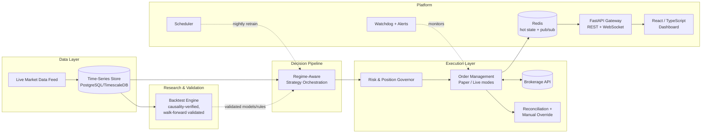

# MarginOps

**A systematic multi-asset trading platform — research, backtesting, and live order execution
across NSE equities, options, and commodity derivatives.**

> This is a **public engineering overview**, not the trading source code. The full
> implementation (signal construction, position sizing, risk models, regime logic, and live
> trading source) lives in a private repository and stays private — it represents the
> proprietary research and engineering behind the system. This repository documents the
> architecture, infrastructure, and engineering practices only.

---

## Overview

MarginOps is a solo-built systematic trading platform spanning the full lifecycle of a
quantitative trading system: historical data ingestion, a causality-verified backtesting
engine, a regime-aware decision pipeline, and a live/paper execution layer trading through a
live brokerage API on NSE equities, index/stock options, and MCX commodity derivatives.

It's built as a real operating system for a trading strategy, not a research notebook — with
the infrastructure that separates "backtested well" from "safe to run unattended with real
capital": paper/live execution parity, atomic order submission, automated broker reconciliation,
a hard-gated live-trading switch, scheduled model retraining, and a real-time monitoring
dashboard.

## Motivation

Most public quant/trading projects stop at the backtest. The interesting — and hardest —
engineering problems start after a strategy backtests well: proving the backtest itself isn't
lying to you (look-ahead bias, overfitting, survivorship effects), and then building the
execution, risk, and observability layers that let a system act on real capital safely and
unattended. MarginOps was built to own that entire lifecycle, not just the modeling piece.

## By the numbers

| Metric | Value |
|---|---|
| Codebase | ~24,000 lines of Python + TypeScript across 289 files |
| Automated tests | 22+ pytest modules (data layer, backtest, regime parity, live watchdog, reconciliation, risk guards, paper broker) |
| Historical data | Broker-verified dataset, 450+ instruments, 500K+ price bars |
| Asset coverage | NSE equities, index/stock options, MCX commodity options & futures |
| Build cadence | 146 commits over a ~6-week intensive solo build |
| Validation methodology | In-sample / out-of-sample / walk-forward, causality-verified (zero look-ahead bias) |
| Validation outcome | Consistently profitable out-of-sample and across walk-forward windows — not just an in-sample fit |

*(Statistics describe engineering scope, scale, and validation outcome only — no strategy
performance figures, such as returns, Sharpe, profit factor, or drawdown, are published here or
anywhere publicly, by design.)*

## High-level architecture

The decision pipeline is intentionally shown as a single block — the internal logic (regime
classification, strategy selection, signal generation, sizing) is the proprietary part of the
system and isn't detailed here or anywhere public.

## Engineering challenges

- **Proving the backtest isn't lying to you.** Built a dedicated causality test to verify the
  backtest engine has zero look-ahead bias, rather than assuming correctness from code review
  alone — a bug at the engine level would produce false-optimistic results across every
  strategy tested through it.
- **Backtest/live parity.** Paper and live trading run the same decision code path so that
  "validated in paper" is a genuine rehearsal of live behavior, while keeping paper and live
  analytics fully separated so simulated activity never contaminates real reporting.
- **Safe unattended execution.** Atomic bracket-order submission (entry, stop, and target as
  one unit) removes the window where a network blip could leave a position unprotected;
  idempotent order handling makes retries safe; a reconciliation process continuously checks
  internal state against the broker's ground truth.
- **Graceful degradation.** The live system runs on a JSON-ledger fallback when Postgres/Redis
  aren't available — richer persistence is an enhancement, not a hard dependency.
- **Multi-asset unification.** Equities, options, and commodity futures/derivatives are composed
  under one capital and risk model instead of being run as siloed sub-systems.
- **Autonomous daily operation.** Scheduled retraining, watchdog processes, and OS-level task
  scheduling keep the system running unattended without manual daily intervention.

## Technology stack

**Backend / research:** Python 3.11, pandas, NumPy, SciPy, LightGBM, scikit-learn, SQLAlchemy,
pytest

**Live platform:** FastAPI, WebSocket streaming, Pydantic, Prefect (scheduled retraining and
re-validation), structured logging

**Data:** PostgreSQL + TimescaleDB (time-series storage), Redis (hot state + pub/sub), JSON
ledger fallback for degraded-infra resilience

**Frontend:** React 18, TypeScript, Vite, Tailwind CSS, Recharts

**Infra / ops:** Docker Compose (one-command local stack), watchdog + scheduled-task automation
for unattended daily operation

## Screenshots

*(To be added — captured from paper-trading sessions only, with all figures either
demo/scrubbed or clearly paper-labeled. No live P&L, position sizes, or strategy-level
performance data will ever appear here.)*

Planned: dashboard overview, system health / observability view, order-flow monitor (paper
data), architecture diagram render.

## Future work

- Broaden observability (metrics/alerting depth) around the live execution loop
- Extend automated test coverage as new asset classes are integrated
- Additional resilience work around broker connectivity failure modes

## What this repository is not

This is a documentation-only showcase. It does not include: strategy/signal source code,
position-sizing or risk-calculation logic, regime-classification implementation, configuration
files, credentials, or any historical performance data. Those remain in a private repository.

---

Built solo by Aditya Magar. Get in touch via the contact details on my resume/LinkedIn.
